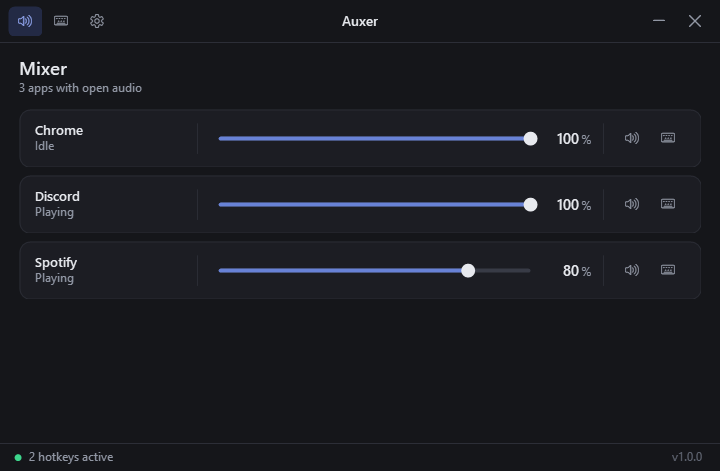
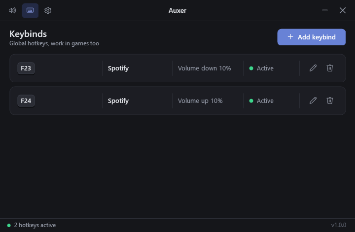
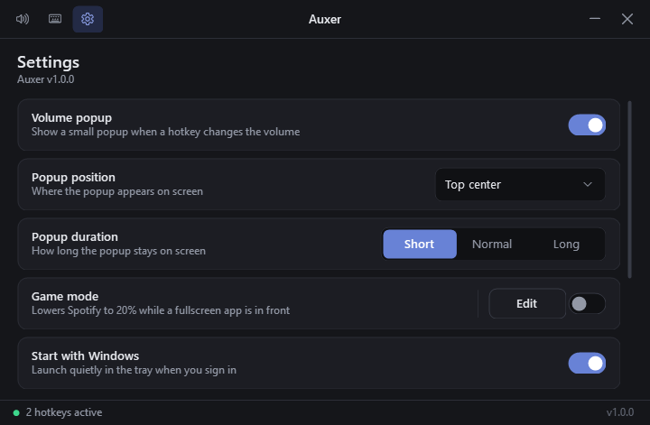

<p align="center">
  
</p>

<h1 align="center">Auxer</h1>

<p align="center">
  Per-app volume control for Windows, with global hotkeys.<br>
  Turn Spotify down mid-game without alt-tabbing.
</p>

<p align="center">
  
</p>

## Features

- **Global hotkeys per app:** volume up/down by any step, toggle mute, or jump to a set level. They work in fullscreen games too, and you can hold a key to keep adjusting.
- **"Focused app" hotkeys:** one key controls whatever window is in front.
- **Tray panel:** click the tray icon for a quick slider per app.
- **Mixer:** a live slider and mute button for every app with audio. Right-click an app to hide it.
- **Game mode:** automatically lowers your music while a game (any fullscreen app, or games you pick) is in front, and restores it when you leave.
- **Volume popup:** a small "Spotify 35%" popup that never steals focus from your game. You can set its position and duration.
- **Lightweight:** one ~400 KB exe and about 20 MB of memory in the tray. It does no background polling while its windows are closed.

<p align="center">
  
  
</p>

## Download

1. Download `Auxer.exe` from the [latest release](https://github.com/TomasNv07/Auxer/releases/latest).
2. Install the [.NET 9 Desktop Runtime](https://dotnet.microsoft.com/download/dotnet/9.0) if you don't have it. Under ".NET Desktop Runtime", pick the Windows x64 installer.
3. Run `Auxer.exe`. No install needed.

> Windows SmartScreen may warn about an unrecognized app because the exe isn't code-signed. Click **More info → Run anyway**, or build it yourself from source.

Requires Windows 10 or 11 (x64).

## Usage

- **Add a hotkey:** open the **Keybinds** page and click **Add keybind**. Pick an app (or **Custom…** to type a program name like `cs2`), choose an action, click **Click to set hotkey** and press your combo.
- **Tray icon:** left-click it for the volume panel, double-click it to open the window, and right-click it to pause hotkeys or exit.
- **Closing the window** keeps Auxer running in the tray. Turn on **Start with Windows** in Settings to have it always ready.
- **Shortcuts:** Ctrl+1 / Ctrl+2 / Ctrl+3 switch between the Mixer, Keybinds and Settings pages.

An app shows up once it has opened audio since it started (for Spotify, after pressing play once). Hotkeys look the app up by name each time you press them, so they also work for apps that start later.

Settings are stored in `%APPDATA%\Auxer\settings.json`.

## Build from source

Requires the [.NET 9 SDK](https://dotnet.microsoft.com/download/dotnet/9.0) on Windows.

```powershell
git clone https://github.com/TomasNv07/Auxer.git
cd Auxer
dotnet publish -c Release -o dist
```

The exe ends up in `dist\Auxer.exe`. The app icon is generated by `tools\make-icon.ps1`.

## License

[MIT](LICENSE)
